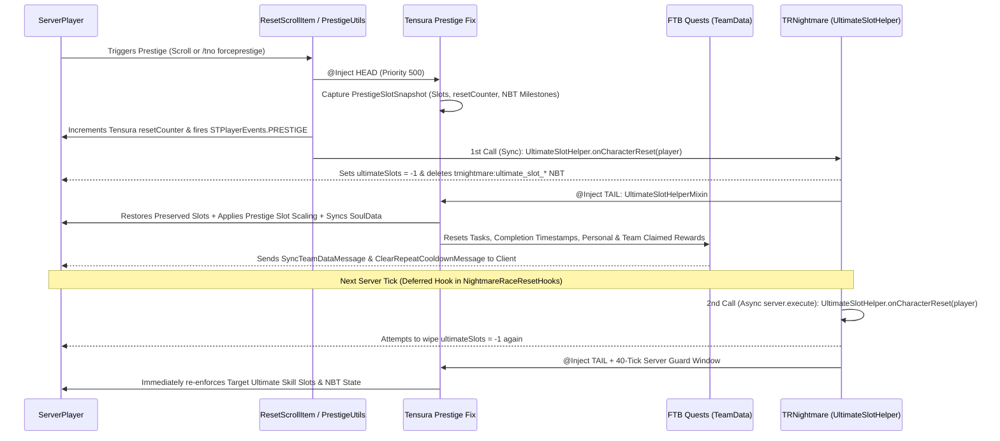

# Tensura Prestige Fix (`tensura_prestige_fix`)

[](https://minecraft.net)
[](https://neoforged.net)
[](https://adoptium.net)
[](#deployment--installation)
[](LICENSE)

A lightweight, server-and-client compatible **NeoForge 1.21.1** utility and bugfix mod engineered for **Tensura: Reincarnated** servers and modpacks running **SlimeThroneExtras (`stextras`)**, **TRNightmare (`trnightmare`)**, **Tensura: The New Order (`tensura_tno`)**, and **FTB Quests (`ftbquests`)**.

---

## 📌 Executive Summary

When a player **Prestiges** in the modpack (either by consuming a *Character Reset Scroll* while meeting Prestige requirements or via `/tno forceprestige`), their Tensura `resetCounter` increases to grant additional starting Unique Skill slots. However, **two severe progression bugs** occur in the unpatched modpack:

1. **FTB Quests Rewards & Progress Do Not Reset:** Main quest progression, task progress, repeatable cooldowns, and—most importantly—**claimed quest rewards** (`TeamData.claimedRewards`) remain permanently marked as claimed, preventing players from re-completing quests and re-claiming rewards on subsequent Prestige runs.
2. **TRNightmare Ultimate Skill Slots Reset Back to `1`:** Instead of preserving earned Ultimate Skill Slots and scaling them up per Prestige, `TRNightmare` forcibly wipes the player's Ultimate Skill Slots back to `1` (`DefaultUltimateSlots`) during character reset.

**`Tensura Prestige Fix`** resolves both issues automatically on the server (and in singleplayer/LAN) with zero client-side packet incompatibilities, full configuration support, and retroactive recovery for players who already Prestiged prior to installing this mod.

> **Pre-Built Release Binary:**
> A ready-to-deploy JAR is included directly in this repository at [`releases/tensura-prestige-fix-1.0.0.jar`](releases/tensura-prestige-fix-1.0.0.jar).

---

## 🔄 Prestige Execution Flow



---

## 🔍 Technical Root Cause Analysis

### 1. Why FTB Quests Rewards & Progress Failed to Reset on Prestige
* **Unpatched Behavior:**
  * When a player Prestiges via `io.github.manasmods.tensura.item.misc.ResetScrollItem` (hooked by `SlimeThroneExtras`'s `ResetScrollItemMixin` and `org.crypticdev.stextras.utils.PrestigeUtils#doPrestige(ServerPlayer)`), `PrestigeUtils` only rerolls `SlimeThroneExtras`'s internal daily/weekly quests and increments `ITensuraPlayer#getResetCounter()`.
  * Neither `SlimeThroneExtras` nor `tensura_tno` resets standard **FTB Quests** chapters, quests, tasks, or claimed rewards upon `STPlayerEvents.PRESTIGE`.
  * Furthermore, in `dev.ftb.mods.ftbquests.quest.TeamData`, quest rewards can be scoped either to the individual player (`player.getUUID()`) or to the entire team (`net.minecraft.Util.NIL_UUID` when `isTeamReward()` is enabled). Simply resetting task progress does not clear team-wide claimed reward records.
* **Our Solution (`FtbQuestsPrestigeResetHandler`):**
  * Listens to `STPlayerEvents.PRESTIGE`, `STPlayerEvents.PRESTIGE_LEVEL`, and `ResetScrollItem#resetEverything(ServerPlayer)` (with a 5-tick deduplication guard so quests are never reset twice during the same Prestige).
  * Temporarily unlocks `TeamData` if locked, iterates over all chapters and quests in `ServerQuestFile.INSTANCE` (skipping any hex IDs configured in `excludedChapterIds` / `excludedQuestIds`), and performs a four-stage reset:
    1. **Standard Progress Reset:** Executes `quest.forceProgressRaw(teamData, new ProgressChange(quest, playerUuid).setReset(true))`.
    2. **Explicit Task Zeroing:** Calls `teamData.setProgress(task, 0L)` and clears `started` and `completed` timestamps for every task, quest, and chapter.
    3. **Personal & Team-Wide Reward Reset:** Calls `teamData.resetReward(playerUuid, reward)`, `teamData.resetReward(Util.NIL_UUID, reward)`, and `teamData.deleteReward(reward)` for every quest reward so all rewards can be claimed again in the new Prestige cycle.
    4. **Cooldown & Live Client Sync:** Calls `teamData.clearRepeatCooldown(quest)`, sends `ClearRepeatCooldownMessage`, marks `TeamData` dirty (`clearCachedProgress()`, `markDirty()`, `saveIfChanged()`), and dispatches `new SyncTeamDataMessage(teamData)` via Architectury `NetworkManager.sendToPlayer(...)` so the player's Quest Book GUI updates immediately without relogging.

---

### 2. Why TRNightmare Ultimate Skill Slots Reset Back to `1` on Prestige
* **Unpatched Behavior (Three Compounding Bugs in `trnightmare-1.0.5.2.1`):**
  1. **Unreferenced Scaling Method (Dead Code):**
     `com.github.hvnbael.trnightmare.util.UltimateSlotHelper` contains a method `public static void onResetCounter(Player player)` specifically written to grant additional Ultimate Skill Slots when a player resets (`UltimateSlotResetEarn` slots every `UltimateSlotResetEarnRate` resets, up to `UltimateSlotResetMaxEarned` in `UltimateSlotConfig.INSTANCE`). **However, `UltimateSlotHelper.onResetCounter(Player)` is never called anywhere in `TRNightmare`'s codebase.**
  2. **Destructive Reset Logic (`onCharacterReset`):**
     `UltimateSlotHelper.onCharacterReset(Player)` executes:
     ```java
     SoulData soulData = SoulCapabilityProvider.resolve(player);
     soulData.setUltimateSlots(-1);
     SoulCapabilityProvider.persist(player, soulData);
     CompoundTag tag = player.getPersistentData();
     tag.remove("trnightmare:ultimate_slot_self_naming");
     tag.remove("trnightmare:ultimate_slot_awakening");
     tag.remove("trnightmare:ultimate_slot_reset_progress");
     tag.remove("trnightmare:ultimate_slot_reset_earned");
     tag.remove("trnightmare:pending_ultimate_evolutions");
     ```
     Because `ultimateSlots` is set to `-1`, the next call to `UltimateSlotHelper.getSlotCount(player)` triggers `initializeSlots(player, soulData)`, resetting the player's Ultimate Skill Slots back to `DefaultUltimateSlots = 1` and erasing all Prestige/Awakening/Self-Naming slot history.
  3. **Synchronous + Next-Tick Deferred Double Wipe:**
     When a player consumes a *Character Reset Scroll*, `TRNightmare` invokes `SoulCapabilityProvider.onCharacterReset(ServerPlayer)` **twice**:
     * **Call #1 (Synchronous):** `TensuraResetScrollSoulMixin#trnightmare$afterResetEverything` at the tail of `ResetScrollItem.resetEverything`.
     * **Call #2 (Deferred to Next Server Tick):** `NightmareRaceResetHooks#onResetScrollConsumed` (`LivingEntityUseItemEvent.Finish`) schedules `serverPlayer.server.execute(() -> SoulCapabilityProvider.onCharacterReset(serverPlayer))`. Even if a listener restores slots during `STPlayerEvents.PRESTIGE`, the deferred lambda on the next server tick wipes them back to `1` again.
* **Our Solution (`UltimateSlotPrestigeHandler` & Mixins):**
  1. **Pre-Reset Snapshot Capture:** `ResetScrollItemPrestigeMixin` and `PrestigeUtilsMixin` inject at `@At("HEAD")` with `priority = 500` (before `SlimeThroneExtras` and `TRNightmare` mixins) to record the player's pre-reset Ultimate Skill Slot count, Tensura `resetCounter` (`TensuraStorages.getPlayerDataFrom(player).getResetCounter()`), and `trnightmare:ultimate_slot_*` NBT keys.
  2. **Slot Preservation & Prestige Scaling:** When Prestige is confirmed (via `STPlayerEvents.PRESTIGE`, `STPlayerEvents.PRESTIGE_LEVEL`, or `resetCounter` increment), `UltimateSlotPrestigeHandler` preserves the player's existing Ultimate Skill Slots and calculates new Prestige bonus slots according to `UltimateSlotConfig.INSTANCE` (`UltimateSlotResetGain`, `UltimateSlotResetEarn`, `UltimateSlotResetEarnRate`, `UltimateSlotResetMaxEarned`) plus any extra bonus configured in `tensura_prestige_fix-common.toml`.
  3. **Deferred Wipe Interception & 40-Tick Guard:** `UltimateSlotHelperMixin` hooks `@At("TAIL")` of `UltimateSlotHelper.onCharacterReset(Player)` and `UltimateSlotPrestigeHandler.onServerTickPost` maintains a 40-tick (2-second) enforcement window so the next-tick `server.execute(...)` call in `NightmareRaceResetHooks` is immediately neutralized and synced via `SoulCapabilityProvider.persist(player, soulData)`.
  4. **Retroactive Login Recovery:** When existing players log in (`PlayerEvent.PlayerLoggedInEvent`), `recoverMissingPrestigeSlotsIfNeeded` compares their Tensura `resetCounter` against their current Ultimate Skill Slots and automatically restores any Prestige slots that were wiped before this mod was installed.

---

## 📦 Deployment & Installation

### Server / Client Requirements
* **Minecraft:** `1.21.1`
* **Mod Loader:** `NeoForge 21.1.x` (tested against `21.1.250`)
* **Java:** `Java 21`
* **Supported Mods (Optional at load time; features activate automatically when present):**
  * `tensura` (`tensura-neoforge-2.0.1.3.jar`)
  * `stextras` (`SlimeThroneExtras-neoforge-2.1.2.1.jar`)
  * `trnightmare` (`trnightmare-1.0.5.2.1-neoforge-1.21.1.jar`)
  * `ftbquests` (`ftb-quests-neoforge-2101.1.34.jar`)

### Installation Steps
1. Download [`releases/tensura-prestige-fix-1.0.0.jar`](releases/tensura-prestige-fix-1.0.0.jar).
2. Copy the `.jar` file into the **`mods/`** directory of your **Dedicated Server** (and/or **Client** for Singleplayer / LAN / Modpack distribution).
   * *Note:* On a multiplayer server, this mod works **server-side** without requiring players to install it on their client (it uses `ftbquests` and `trnightmare`'s built-in network packets to sync data to clients), and it is also 100% safe to include in both Server and Client modpacks.
3. Start the server once to generate the configuration file at `config/tensura_prestige_fix-common.toml`.

---

## ⚙️ Configuration Reference (`config/tensura_prestige_fix-common.toml`)

```toml
[ftb_quests_reset]
	#If true, automatically resets a player's FTB Quests progress and claimed rewards when they Prestige.
	resetFtbQuestsOnPrestige = true
	#If true, resets all claimed quest rewards for the prestiging player so rewards can be claimed again in the new Prestige run.
	resetClaimedRewards = true
	#If true, also resets rewards marked as 'Team Reward' (stored under NIL_UUID in FTB Quests) for the player's FTB Team.
	resetTeamWideRewards = true
	#If true, clears repeatable quest cooldown timers upon Prestige.
	resetRepeatCooldowns = true
	#List of FTB Quests Chapter hex IDs (e.g. ["1A2B3C4D5E6F7A8B"]) that should NOT be reset on Prestige.
	excludedChapterIds = []
	#List of individual FTB Quest hex IDs (e.g. ["0F1E2D3C4B5A6978"]) that should NOT be reset on Prestige.
	excludedQuestIds = []
	#If true, sends a chat confirmation message to the player when their FTB Quests progress and rewards are reset on Prestige.
	notifyPlayerOnQuestReset = true

[ultimate_skill_slots]
	#If true, prevents TRNightmare's character reset hooks from wiping the player's Ultimate Skill Slots back to 1 when Prestiging.
	preserveUltimateSlotsOnPrestige = true
	#If true, also preserves Ultimate Skill Slots on a regular Character Reset Scroll full reset even if it was not a Prestige.
	preserveUltimateSlotsOnAnyFullReset = false
	#If true, Tensura Prestige Fix preserves TRNightmare's reset tracking tags and grants Prestige Ultimate Skill Slots according to trnightmare-common.toml.
	triggerTrNightmareResetSlotScaling = true
	#Additional flat Ultimate Skill Slots granted per Prestige ON TOP OF TRNightmare's onResetCounter scaling.
	#Range: 0 ~ 100
	extraUltimateSlotsPerPrestige = 0
	#Overrides TRNightmare's ultimateSlotResetMaxEarned cap (which defaults to 4 in trnightmare-common.toml).
	#Set to -1 to use TRNightmare's config value, 0 for unlimited Prestige slot scaling, or a positive integer for a custom cap.
	#Range: -1 ~ 1000
	overrideMaxUltimateSlotsFromPrestige = -1
	#If false (recommended when preserving total slots), keeps the 'awakening' and 'self_naming' slot milestone flags matching the preserved slots.
	#If true, clears the 'awakening' and 'self_naming' milestone flags on Prestige so the player can earn them again in the new run.
	resetAwakeningAndNamingMilestonesOnPrestige = false
	#If true, when a player logs in, checks their Tensura resetCounter and automatically restores any missing Prestige Ultimate Slots wiped prior to installing this mod.
	autoRecoverPrestigeSlotsOnLogin = true
	#If true, sends a chat summary to the player showing their preserved/updated Ultimate Skill Slot count after Prestige.
	notifyPlayerOnSlotRestore = true
```

---

## 💻 Commands & Permissions

| Command | Permission Level | Description |
| :--- | :---: | :--- |
| `/prestigefix status` | `0` (All Players) | Displays your current Tensura Prestige count (`resetCounter`), TRNightmare Ultimate Skill Slots, Prestige slots earned (`reset_earned` / `reset_progress`), and milestone flags (`Self-Naming`, `Awakening`). |
| `/prestigefix status <player>` | `2` (OP / Admin) | Displays Prestige and Ultimate Skill Slot diagnostics for `<player>`. |
| `/prestigefix resetquests [player]` | `2` (OP / Admin) | Manually resets all FTB Quests progress, claimed rewards, and repeat cooldowns for yourself or `<player>` (respecting config exclusions) and immediately syncs `TeamData` to the client. |
| `/prestigefix recoverslots [player]` | `2` (OP / Admin) | Manually recalculates and restores any missing Prestige Ultimate Skill Slots for yourself or `<player>` based on their Tensura `resetCounter`. |
| `/prestigefix setslots <player> <slots>` | `2` (OP / Admin) | Directly sets `<player>`'s TRNightmare Ultimate Skill Slots (`0..100`) and persists/syncs `SoulData` to the client. |

---

## 🛠️ Project Structure & Building from Source

### Repository Layout
```text
├── build.gradle
├── gradle.properties
├── settings.gradle
├── LICENSE
├── README.md
├── releases/
│   └── tensura-prestige-fix-1.0.0.jar
└── src/
    └── main/
        ├── java/com/github/tensuraprestigefix/
        │   ├── TensuraPrestigeFix.java
        │   ├── command/
        │   │   └── PrestigeFixCommands.java
        │   ├── config/
        │   │   └── PrestigeFixConfig.java
        │   ├── handler/
        │   │   ├── FtbQuestsPrestigeResetHandler.java
        │   │   └── UltimateSlotPrestigeHandler.java
        │   └── mixin/
        │       ├── PrestigeFixMixinPlugin.java
        │       ├── PrestigeUtilsMixin.java
        │       ├── ResetScrollItemPrestigeMixin.java
        │       └── UltimateSlotHelperMixin.java
        ├── resources/
        │   ├── META-INF/neoforge.mods.toml
        │   └── tensura_prestige_fix.mixins.json
        └── templates/
            └── META-INF/neoforge.mods.toml
```

### Building with Gradle
1. Place the following modpack JARs into the project's `libs/` directory for compile-time symbol resolution:
   * `tensura-neoforge-2.0.1.3.jar`
   * `manascore-*.jar`
   * `SlimeThroneExtras-neoforge-2.1.2.1.jar`
   * `trnightmare-1.0.5.2.1-neoforge-1.21.1.jar`
   * `ftb-quests-neoforge-2101.1.34.jar`
   * `ftb-library-neoforge-2101.1.32.jar`
   * `ftb-teams-neoforge-2101.1.9.jar`
   * `architectury-13.0.11-neoforge.jar`
2. Run the Gradle build task with JDK 21:
   ```bash
   ./gradlew build
   ```
3. Retrieve the compiled artifact from `build/libs/tensura-prestige-fix-1.0.0.jar`.

---

## 📄 License

Distributed under the [MIT License](LICENSE).
